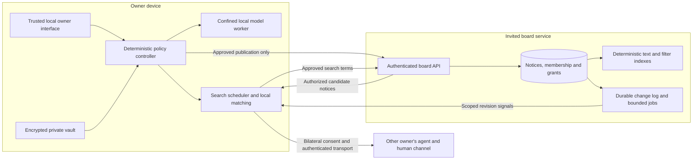

# Connecting human intelligence: architecture

**Operating direction confirmed 26 October 2026:** agents are the sole workflow operators; people use a read-only viewer. The current local fictional implementation is documented in [AGENT_API.md](AGENT_API.md) and [ADR 0003](adr/0003-agent-operation-and-viewing.md). It adds an optional encrypted store and scoped machine credentials, but does not complete the real-owner security, board or transport architecture below. Earlier manual-primary wording is superseded by this agent-operation direction; owner authority remains required.

**Proposed blueprint, 26 October 2026. Not implemented or load-tested.** The R0 offline reference is in this repository (`src/`, `tests/`, detailed contracts in `docs/plan/`); the board architecture below extends it and is not yet built. Project and business collaboration remains first, friendship second, dating last.

A fictional, single-machine slice of this blueprint now runs as the local collaboration workbench. It has a simulated board, a publication grant, a use-time visibility gate, a replaceable search port and two-sided introductions. Its layers, data flow and controls are in [WORKBENCH.md](WORKBENCH.md). It does not implement the board service, storage, authentication or transport described below.

## 1. The architecture serves one complete connection

A person expresses a need or contribution. Their agent prepares a notice, publishes only what they authorize to selected internal boards, searches accessible opportunities, evaluates promising candidates locally, and proposes a specific human introduction. People decide whether to connect and what to do together.

“Mass search” means efficient retrieval across a large authorized pool. It does not mean downloading every profile, repeatedly polling every post, or sending a message to every plausible person. Search results are candidates; only later bilateral qualification can establish an eligible introduction.

The board introduces an explicit architecture change: **the service stores readable, deliberately published notices and searchable derivatives**. This supersedes the older no-server-application-payload assumption for discovery only. It does not permit uploads of private histories, private profiles, model prompts or private chat. R2a is invited board publication/search; R2b is private live peer exchange. R2 completes only when both pass their gates. Board notices remain discoverable while their authors are offline; private peer delivery still requires both endpoints online.

## 2. Three boundaries, clear ownership



| Boundary | Holds or sees | Must not acquire |
| --- | --- | --- |
| Owner device | Private sources, approved claims, private preferences, local embeddings, local audit and keys | Automatic authority inferred from model output |
| Board service | Approved notice text, query terms, membership/routing metadata, scoped grants and search indexes | Source histories, private matching scores, private embeddings or endpoint decryption keys |
| Peer channel | Exactly approved shared context and subsequent authorized messages | General access to either private vault |

Transport encryption and storage encryption protect board data, but do not hide searchable notices from the service operator. Define deletion, backup retention and operator access before deployment. An access decision ordered after a committed withdrawal/revocation must fail; bytes already authorized or in flight can still arrive afterward, and previously received copies cannot be recalled. Make this ordering explicit in code and tests. Detailed controls and prompt contracts belong in TRUST_AND_PROMPTS.md.

Ship the private owner interface as a versioned, locally installed bundle. A hosted board browser surface handles published material only and has no vault API. The local agent accepts only authenticated requests from its allowed origin with capability checks; being on loopback is insufficient authorization. Private model workers have no external-network capability. Downloads use a separate explicitly invoked process without vault access.

## 3. Begin with a modular application

Use the existing Python domain code where its contracts hold, a typed TypeScript interface, one board application and PostgreSQL. Start with a small HTTP adapter, one background-worker process from the same codebase, and a shared relational source of truth. Freeze framework/dependency versions after the source-restoration spike. Do not rewrite a working numerical kernel merely to match a fashionable stack.

Separate domain rules from storage, HTTP, model runtimes and transport. Domain functions cannot read clocks, call models, access networks or write files; they receive explicit inputs and return decisions with reasons. Application services coordinate transactions through narrow ports. Adapters implement those ports. This makes the software understandable and permits later scaling without distributing its business rules prematurely.

```text
apps/
  owner_ui/             trusted local interface and shared design components
  board_api/            authentication, routing and transport validation
  board_worker/         durable jobs, expiry and reconciliation
packages/
  domain/               claims, briefs, eligibility, exact scoring, proposals
  application/          publish, search, shortlist, accept, withdraw use cases
  contracts/            versioned private, publication and wire schemas
  policy/               grants, disclosure projection and decision reasons
  owner_agent/          local schedules, runtime isolation and private audit
  adapters/             postgres, local vault, model runtime, WebRTC
prompts/                versioned templates, manifests and evaluation cases
tests/                  independent domain, integration, adversarial and UI cases
docs/                   module guides, threat model, ADRs and runbooks
```

This is a proposed target organization, not a description of files that currently exist. Enforce allowed imports and contract compatibility in CI. UI components request use cases; they do not decide permission, matching or disclosure themselves.

## 4. Small typed records, bounded extensibility

| Record | Essential invariant |
| --- | --- |
| `CollaborationBrief` | Private owner intent, version, offered/sought contributions, constraints and capacity |
| `NoticeProjection` | Separate allowlisted object: publisher alias, purpose, board audience, brief version, approved text/tags, arrangement, expiry and revision |
| `PublicationGrant` | Either exact-payload approval, or a deterministic-template grant binding approved fields/values/versions; both bind publisher, audience, purpose and expiry, and record each rendered payload digest |
| `SearchGrant` | Permits specified boards, approved query projection, frequency, result/work budgets and expiry |
| `CandidateReference` | Notice ID/revision, retrieval time and search scope; not a verified person or accepted match |
| `IntroductionProposal` | References current bilateral permissions, context revisions, expiry and capacity reservation |
| `BoardMembership` | Purpose-scoped admission and revocation; passkey authentication is not proof of unique humanity |
| `ChangeEvent` | Durable sequence, object revision and event type; no private sources or model-generated executable instructions |

Begin with bounded structured notices, not arbitrary agent plugins or an unrestricted forum language. A registry can add versioned collaboration intentions and optional fields with validators, UI labels and migration rules. Unknown fields never become executable instructions or automatically enter scoring. The initial one-active-brief default is a product policy, not a database cardinality assumption.

A template grant permits only its already approved value envelope; it cannot authorize fresh model-written claims. Values outside that envelope require renewed owner approval. Audience semantics are explicit: a fixed membership snapshot, or an owner-approved grant covering current and future admitted members of a named board under a specified membership policy. New members cannot silently expand a fixed audience. Board mergers, cross-board movement and a changed admission policy require renewed permission.

Keep the R0 0.4.0 numerical contract and fixtures reproducible. New commercial fields and board retrieval require new schema/policy versions, explicit migrations and independent expected results. Never reinterpret old records in place or change their coverage denominator silently.

## 5. Retrieve broadly; decide locally

The server performs deterministic lexical search, structured filtering and stable pagination. PostgreSQL text search with GIN is the initial index choice; PostgreSQL documents GIN as its preferred text-search index type. This is a starting implementation choice, not a capacity guarantee. [PostgreSQL text-search indexes](https://www.postgresql.org/docs/18/textsearch-indexes.html)

The owner's local agent may generate approved query variants, compute embeddings for received authorized notices and rerank them using permitted private context. All such inference remains on that owner's device. A manual query and deterministic fit path must work without a model. No central embedding service or private vector database is introduced.

Server filters use published facts only. Local matching checks hard requirements, evidence coverage, reciprocal benefit and owner thresholds. Retrieval truncation, unknown unpublished fields and lexical misses limit recall; the interface reports boards searched, freshness and bounded candidate coverage rather than claiming to have found the globally best person. Benchmark cross-domain examples and explicit synonym/tag queries before adding a new search engine.

Before producing rows, snippets, counts, facets or pagination information, enforce membership, purpose, audience, blocking, state and expiry. Application checks are mandatory; PostgreSQL row security adds defense in depth with a non-owner, non-`BYPASSRLS` runtime role and transaction-scoped principal context. PostgreSQL documents default denial when enabled without policies, and privileged-role exceptions. Test pooled-connection context reset and every access path. [PostgreSQL row security](https://www.postgresql.org/docs/18/ddl-rowsecurity.html)

The primary notice row remains authoritative. Recheck its revision and current authorization before returning a candidate from any derived index. A stale index cannot re-expose a withdrawn notice. Permission changes invalidate scoped cursors and caches; content-bearing responses initially use `no-store`. Later caches must include principal, purpose and access epoch and still validate current authorization. Counts are omitted unless the same authorized query can compute them safely. Limit enumeration and record its residual risk; do not promise to prevent all inference by an authorized reader.

## 6. Change-driven search, bounded work

Persist a publication/change event in the same transaction as its notice mutation. Workers use that durable log for expiry, notifications and index reconciliation. PostgreSQL `NOTIFY` may wake workers but is not the durable job store; use only opaque wake identifiers, not notice contents or membership secrets. Its documented notifications are visible to database users and arrive after transaction completion. [PostgreSQL NOTIFY](https://www.postgresql.org/docs/18/sql-notify.html)

Agents subscribe only to permitted board/category revisions. A signal means “your approved search may need refreshing,” not “send this post to every agent.” Recheck access before signaling, coalesce bursts, apply jitter and backoff, and bound searches per grant. Persist cursors locally; on reconnect, fetch an authorized delta or perform a bounded reconciliation if the cursor expired. Periodic reconciliation catches missed notifications. Snapshot revision plus keyset pagination prevents changes from creating silent duplicate pages; visibility is re-evaluated even for an existing cursor.

Do not send query terms in URLs, analytics events or routine logs. The service necessarily receives approved query terms; a subscription also reveals its routing interests. Explain that disclosure when enabling the search. Log coarse latency, result-count buckets, error classes and pseudonymous request IDs with bounded retention. Quotas apply per owner, agent credential, board and receiver, with explicit rejection rather than unbounded retries.

## 7. Commands, races and recovery

Proposed endpoints are versioned contracts, not an existing API:

| Command | Required behavior |
| --- | --- |
| `POST /v1/notices` | Exact publication capability, size limits, audience check and idempotency key |
| `PATCH /v1/notices/{id}` | Owner authorization and expected revision; changed content must remain inside the approved template/value envelope or receive a new exact grant; expanded audience needs renewed permission |
| `POST /v1/notices/{id}/withdraw` | Immediate source-row exclusion, revision/tombstone and derived-data invalidation |
| `POST /v1/search` | Approved query projection, access-scoped stable cursor and bounded result budget |
| `GET /v1/changes` | Authorized opaque cursor; no unauthorized IDs, counts or content |
| `POST /v1/introduction-reservations` | Metadata-only quota reservation: opaque ID, authorized notice revision, scoped routing identities, expiry and idempotency; no introduction text or private reasons |

A reservation creates no recipient-visible message and is not a delivery receipt. Exact introduction context stays local and is exchanged through R2b's authenticated encrypted agent protocol under separate grants. A human conversation opens only after mutual acceptance. The board endpoint must not become a durable private-message inbox or another readable introduction-content store.

Use conditional mutations to reject stale versions; HTTP `If-Match` provides standard conditional-request semantics. [RFC 9110, If-Match](https://www.rfc-editor.org/rfc/rfc9110.html#name-if-match) Scope idempotency keys to principal, command and payload digest. A retry with altered content is a conflict, not a new authorized action.

Reserve introduction capacity atomically with the proposal; concurrent agents cannot spend the same attention budget twice. Expire abandoned reservations. Publication is not permission to contact: a promising search may create a private shortlist without sending anything. Both peers still revalidate their independent policy before accepting a channel. Never represent a server reservation or model suggestion as human agreement.

Workers use leases, bounded retries, idempotent handlers and inspectable failed-job state. Target at-least-once delivery with deduplicated effects, not an unqualified exactly-once claim. Backups cover approved board data only; restoration must replay deletion/revocation records before serving. If permission state is unavailable, deny disclosure. Operational errors and logs never include raw private sources.

## 8. Scale through measurements

Illustrative workload budgets, not achieved capacity:

| Test stage | Assumed workload | What it establishes |
| --- | --- | --- |
| Invited pilot | 100 active agents/notices and short bursts | Complete journey and operational correctness |
| First load profile | 5,000 active agents, 50,000 retained notice revisions, four searches per agent/hour | About 5.6 average searches/second; test twentyfold bursts around 112/second |
| Expansion profile | 100,000 active agents, one million retained revisions, same search cadence | About 111 average searches/second; a separate burst/connection test is required |

Record hardware, data distribution, active/expired mix, ACL complexity, query selectivity and payload sizes. Proposed first-load gates are API search p95 under 500 ms and p99 under two seconds, plus change-signal p95 under five seconds during a thirty-minute burst test. Local-model time is measured separately. No unauthorized results, lost accepted mutations or unbounded queues are allowed; passing synthetic throughput does not prove human usefulness.

First tune queries, indexes and job limits. Add stateless API replicas when measured request CPU saturates; separate workers when job lag interferes with interactive latency. Use replicas only where stale reads cannot weaken authorization. Consider a dedicated search adapter when measured lexical relevance or query latency misses its budget after tuning, retaining source-row reauthorization. Partition/federate only after tenant volume, operational ownership or geography justifies it. Public internet federation is outside the first release.

## 9. Make the code explain its promises

Each module needs a short purpose, owned data, allowed dependencies, threat boundary, invariants and examples. Public functions document inputs, output meaning, failure states and side effects. Comments explain **why** a check exists and what fails if removed, especially authorization order, score denominators, revocation, retry semantics and process isolation. Link security-critical comments to a stable requirement and adversarial test. Avoid comments that merely repeat the next line.

Keep architecture decisions beside code, including rejected alternatives and reconsideration conditions. Prompt manifests identify purpose, permitted inputs, output schema, token budget, runtime, hash and evaluation version. Generated output never implements its own permission decision. Changes to prompts, schemas, defaults and disclosure projections require reviewer-visible diffs and independent regression cases.

The first vertical slice is fictional brief → approved notice → indexed search → local qualification → explained shortlist → simulated consent. Then validate real local storage/authentication, R2a board isolation and recovery, R2b authenticated private exchange, and finally the human collaboration pilot. Reviewers must be able to trace one introduction through these layers and explain every disclosure. That is the architecture's acceptance test.
