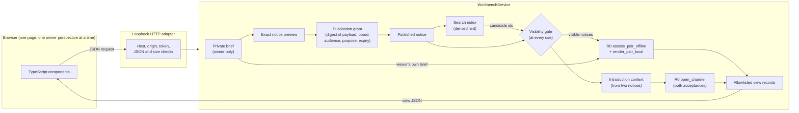

# Local collaboration workbench

> **Fictional prototype.** Every person, board and notice in the workbench is invented. It runs on one computer, keeps everything in memory, and has no accounts, encryption or network transport. The owner switch is a demo perspective selector, **not authentication**. The workbench does **not** complete the R1 secure-owner gate or the R2 networking gates, and it is not ready for real people.

The workbench is the first runnable version of the collaboration journey: one person writes a brief, approves an exact board notice, searches a simulated board, reads an explained shortlist, proposes an introduction, and both people accept the same context before agreeing a small first step. It reuses the R0 matching, explanation, introduction and channel-consent code unchanged.

## Run it

```bash
cd workbench/ui && npm ci && npm run build && cd ../..   # once; needs Node.js 20+
python3 run_workbench.py                                   # http://127.0.0.1:8765/
```

`python3 run_workbench.py --port 9000` picks another port. `--host ::1` binds IPv6 loopback; any other address is refused. Stop with Ctrl+C; all state is discarded.

Browser checks use pinned development-only Playwright and start their own isolated loopback server. Each viewport completes a fresh journey; an existing demo server is never reset by the test:

```bash
cd workbench/ui
npm ci
npm run browsers:install
npm run e2e
```

Screenshots go to `artifacts/workbench/screenshots/` (ignored by git); `SCREENSHOT_DIR` can select a separate evidence directory. The original workbench screenshots remain in [examples/workbench/screenshots/](../examples/workbench/screenshots/). On Windows use `python` in place of `python3` where needed. The browser runner also accepts a `PYTHON` executable path.

## The journey

The seed (`src/agentmatch_workbench/data/seed.json`) has two boards and nine fictional owners. Start as **Marlow** ("I have a project or opportunity") or **Juniper** ("I want to contribute"); both briefs start unpublished.

| Step | What happens | Where |
| --- | --- | --- |
| Brief | Structured fields only: mode, outcome, needs, contributions, availability, time, working arrangement, feedback style, engagement basis and whether it is a requirement, a first step, an optional commercial note and a private note. Each field shows whether it is used for matching, shown in the notice only, or private. | `domain/briefs.py`, `components/briefEditor.ts` |
| Approval | The preview shows the exact notice, board, fixed audience, purpose and expiry. Approval binds a digest of exactly those. Any edit to the brief or the settings makes the approval stale. | `domain/publication.py`, `components/publication.ts` |
| Discovery | Bounded search over approved, active notices on boards the viewer belongs to, with filters and limits of 5, 10 or 20. Each hit is re-checked before it is shown. | `application/service.py:search`, `adapters/lexical_index.py` |
| Shortlist | The R0 scorer assesses both directions from the viewer's brief and the other person's notice. Results are grouped: both sides' preferences met, needs information, not a fit now. Explanations are words, never percentages. | `domain/assessment.py`, `domain/explanations.py` |
| Clarification | A person can explicitly ask about a listed missing public field. The notice owner reviews privately, can decline, and separately approves any revised notice. The requester chooses whether to reassess the current approved revision. | `domain/information.py`, `application/service.py`, `components/informationRequests.ts` |
| Introduction | A five-question shared context built only from both published notices. Each person accepts from their own perspective. The simulated channel opens only when both accepted the same version. | `domain/introductions.py`, `components/introductions.ts` |
| First step | One person proposes a small step, the other agrees, and each reports separately whether it happened. A missing report stays missing. | `domain/introductions.py:FirstStep` |
| Close | Either participant can close an open connection normally. Both capacity slots are released; existing outcome reports remain history. Closure does not assert completion or usefulness, and does not block the other person. | `domain/introductions.py:close_connection` |

### Capacity and missing-information requests

Pending and open introductions reserve one slot for each owner. Proposal creation checks both owners' current capacity within a service transaction. A full recipient produces a generic refusal; their limit and other connections remain private. The HTTP adapter serializes requests, and a reentrant service lock also protects concurrent direct calls on that service instance. This is an in-process guarantee, not a persistent or distributed reservation system.

Requests can name only a missing feedback style, working arrangement, or undecided engagement basis. Both parties must have approved notices visible to the other person. Before sending, the requester sees which approved alias and field will be disclosed. The command binds both notice revisions and rejects stale references. It sends no private note, draft value, source identifier or free-text message.

The owner can choose **Review my brief**, save a private edit, then separately preview and approve publication. Editing alone never answers a request. Reapproval that still omits the field or leaves it undecided remains pending. An answered request exposes a **Reassess updated notice** action; resolving an unknown can reveal a mismatch as well as a fit. No request implies an introduction or acceptance.

Requests expire within seven simulated days, bounded by the original two notice expiries. A participant can have at most five pending sent requests and five pending received requests, with twenty sent and twenty received per rolling 24 hours. The manual demo uses its simulated clock; the durable agent runtime injects real UTC for this accounting and also expires requests after seven real days. Identical retries do not send twice. Declining cannot be bypassed by repeating the same request against the same notice revision. History remains intact when a window renews; these limits are not production abuse protection.

Current membership, publication authority, expiry and blocks are checked when requests are read or used. A recipient may privately edit while a request is pending; only the previously approved publication is eligible for any disclosure. A requester edit or withdrawal invalidates the exact request context. Unavailable request views hide the counterpart, requested field and notice references. Previously delivered text cannot be recalled.

### What is scored and what is not

Only these brief fields reach the R0 scorer, mapped onto its four atom families (the mapping is a product decision, not a calibrated model):

| Brief field | R0 input |
| --- | --- |
| Needs (primary and also useful) | `capability_complementarity` membership atoms on the other person's offers; the primary need is a hard constraint |
| Focus areas | `goal_problem_alignment` membership atoms |
| Working arrangement and rhythm | `practical_workflow_fit` accepted-value atoms |
| Feedback style | `communication_fit` accepted-value atom |
| Engagement basis, availability | hard constraints only when the owner marks them as requirements |

Title, outcome, stage, hours, start window, commercial note and first step are notice metadata and are never scored. Nothing is extracted from free text. If a published notice leaves out a section, the scorer receives no claim for it, so it is reported as **unknown**, not as a mismatch. An "undecided" engagement basis is also unknown. A notice-derived owner uses the default `selective` threshold, and the explanation says so.

## Layers

```text
src/agentmatch_workbench/          separate package; imports agentmatch, never modifies it
  domain/        pure rules: briefs, publication grants, visibility, assessment mapping,
                 explanations, introductions and first steps; no clock reads, no I/O
  application/   WorkbenchService use cases, ports (Clock, WorkbenchStore, SearchIndex),
                 allowlisted view builders
  adapters/      in-memory store, in-memory lexical index, seed loader, loopback HTTP
  data/seed.json fictional boards, owners and example briefs
workbench/ui/                      TypeScript interface, compiled by tsc; dev-only dependency
  src/contracts.ts, api.ts         typed view records and the request client
  src/components/                  shell, brief editor, publication, discovery, introductions
  static/                          index.html, styles.css, favicon.svg
  e2e/journey.mjs                  browser journey on desktop and mobile
run_workbench.py                   source launcher
```

Search is behind the `SearchIndex` port. The in-memory index is a derived copy that is deliberately *not* updated on expiry, blocks, edits or membership changes: the visibility gate in the service decides at read time, so replacing the index with a real one cannot widen access. Clocks are injected; the HTTP adapter uses a `SimulatedClock` that only moves forward, so expiry can be demonstrated with **+1 day** and **+7 days**.

The original tooling choice is recorded in [adr/0001-local-workbench.md](adr/0001-local-workbench.md). [ADR 0002](adr/0002-workbench-lifecycle-and-clarification.md) records capacity, normal closure, bounded clarification and reproducible browser checks. It supersedes ADR 0001's undeclared-Playwright choice; the application still has no Python runtime dependencies.

## Data flow



Private fields (the private note, the brief's unpublished sections and any claim or source identifiers) are read only when building the owner's own brief view. Every view of another owner is built from their approved notice payload.

## Controls

Each control is deterministic code with tests. Test names are in `tests/test_workbench_publication.py` (P), `tests/test_workbench_journey.py` (J), `tests/test_workbench_http.py` (H), and `tests/test_workbench_lifecycle.py` (L).

| Control | What it prevents | How it is tested | What remains unprotected |
| --- | --- | --- | --- |
| Exact-payload publication grant | Publishing anything other than the previewed notice, board, audience, purpose and expiry | P `test_board_grant_rejects_payload_it_did_not_approve`, `test_changing_preview_settings_invalidates_approval` | The owner can still approve something unwise; the preview only makes it visible |
| Brief edits invalidate approval | A stale approval publishing new content, or an edited brief staying live | P `test_editing_brief_invalidates_pending_publication_approval`, `test_editing_brief_after_publication_suspends_live_notice_until_reapproved` | Nothing; the notice is suspended until re-approved |
| Separate publication permission | A peer-disclosure grant being reused to publish on a board | P `test_peer_disclosure_grant_cannot_authorize_board_publication` | Only two grant kinds exist; template grants from the design are not built |
| Fixed audience snapshot | A member who joins after approval seeing the notice | P `test_member_added_after_approval_is_outside_the_fixed_audience`, `test_outside_audience_board_is_never_retrieved_or_usable` | Membership itself is seed data; there is no invitation flow |
| Visibility gate at use time | Using withdrawn, expired, revoked, blocked or superseded notices through stale results or stale index entries | P `test_expired_notice_is_not_retrieved_even_though_the_index_still_has_it`, `test_stale_card_after_withdrawal_cannot_be_used`, `test_stale_card_after_expiry_cannot_be_used`, `test_old_revision_card_is_refused_after_republication`, `test_blocked_pair_cannot_see_or_use_each_other` | Copies a person made of text they already saw |
| Uniform refusal code | Learning why a notice is unavailable (blocked versus expired) | P visibility tests assert `NOTICE_UNAVAILABLE` | Timing differences are not equalised |
| Allowlisted views and private canaries | Private notes, unpublished sections, claim ids or source refs reaching another owner or a publication | P `test_canary_never_leaves_its_owner`, `test_peer_views_carry_no_claim_ids_or_source_refs`, `test_unselected_optional_sections_are_not_published` | The owner can type private text into a public field; nothing detects that |
| Unknown stays unknown | Treating an omitted section as a negative, or presenting an uncertain pair as a match | J `test_unknown_evidence_remains_unknown`, `test_undecided_required_basis_is_unknown_and_blocks` | The mapping itself is uncalibrated |
| Reciprocal value before fit | Shared topics alone producing an introduction | J `test_shared_topics_without_a_useful_contribution_do_not_qualify` | — |
| Bounded, non-exhaustive search | Implying the shortlist is the best match in the world | P `test_search_is_bounded_and_says_it_is_not_exhaustive`, `test_no_match_search_returns_an_empty_reason` | Lexical search can miss relevant notices; the UI says so |
| Both acceptances, same context | One person's acceptance opening a channel, or an old acceptance surviving a change | J `test_proposing_is_not_accepting_and_one_acceptance_cannot_open_a_channel`, `test_changing_context_invalidates_both_acceptances`, `test_both_owner_perspectives_open_the_channel` | Acceptance is a click; there is no identity behind it |
| Decline, expiry, withdrawal, block | Introductions lingering after either person stops consenting | J `test_decline_closes_for_both`, `test_expiry_before_both_accept`, `test_withdrawn_acceptance_and_withdrawn_notice`, `test_brief_edit_by_recipient_closes_pending_introduction`, `test_block_closes_open_channel_and_hides_notices` | No reporting or moderation path |
| First step states | Treating a proposal or an acceptance as evidence that collaboration happened | J `test_first_step_is_proposed_then_agreed_then_reported_separately`, `test_changed_step_needs_fresh_agreement` | Reports are self-reported and unverified |
| Both-owner capacity reservation | A second distinct proposer overbooking a recipient, including concurrent commands | L `test_distinct_proposers_cannot_overbook_recipient_and_first_can_accept`, `test_concurrent_distinct_proposals_reserve_one_recipient_slot` | Local service lock only; no persistent transactions |
| Normal closure | Completed or unwanted connections occupying capacity until someone is blocked | L `test_normal_close_preserves_reports_releases_capacity_and_is_not_blocking`, `test_normal_close_does_not_invent_an_action_or_require_both_to_leave` | Closing does not establish a useful outcome |
| Exact typed information request | Private-field questions, borrowed identities, stale source/target references and duplicate sends | L `test_repeat_click_is_idempotent_and_cannot_request_private_or_known_fields`, `test_requester_cannot_borrow_another_persons_published_identity`, `test_request_requires_a_current_approved_requester_notice_and_exact_source_preview` | The alias is fictional; no real authentication |
| Explicit publication before answer | A private draft being treated as an answer or approval being inherited | L `test_explicit_request_edit_reapproval_and_fresh_reassessment`, `test_reapproval_with_requested_field_still_omitted_stays_pending`, `test_undecided_basis_stays_unknown_until_explicitly_published_known` | Owners can still voluntarily publish unwise text |
| Request authority and budgets | Stale access after expiry, block, requester edits or membership loss; unlimited repeated requests | L `test_request_expiry_and_requester_edit_stop_future_disclosure`, `test_requester_withdrawal_and_block_stop_future_disclosure`, `test_answer_loses_access_after_membership_revocation`, `test_declined_request_history_cannot_bypass_session_budget`; runtime renewal/migration checks in `test_runtime_recovery.py` | Rolling window and pending bounds, not production moderation or identity |
| Loopback bind and Host allowlist | Network access and DNS-rebinding pages | H `test_T_WB_HTTP_001…`, `test_T_WB_HTTP_008…` | Other software running as the same user can still call the server |
| Origin, Sec-Fetch-Site and per-launch token | Cross-site pages changing state | H `test_T_WB_HTTP_001…`, `test_T_WB_HTTP_002…` | It is a CSRF guard, not authentication; anyone with the page can act as any fictional owner |
| Strict JSON bodies and unknown-field refusal | Oversized, duplicate-key, non-JSON or over-posted requests | H `test_T_WB_HTTP_003…`, `test_T_WB_HTTP_004…`, P `test_all_field_errors_are_reported_and_unknown_fields_refused` | No rate limiting |
| Static file confinement and CSP | Path traversal, inline scripts, framing, third-party requests | H `test_T_WB_HTTP_005…`, `test_T_WB_HTTP_008…` | No TLS; loopback traffic is plain HTTP |
| Free text rendered as text | A notice's commercial note acting as markup or instructions | The UI sets `textContent` only; the seed includes an instruction-shaped note (Brook) shown as plain text in the e2e run | No model reads the text yet, so prompt-injection containment for models is untested |

## Implemented controls versus future prompt contracts

The workbench has **no model**. Its three planned prompt contracts (notice drafting, query planning, local explanation) are future designs. Everything the workbench decides is decided by the deterministic code above. When a model is added, it may only propose a structured brief, query or wording; the controls in this table stay the authority, and the free-text-as-data handling becomes a tested model boundary.

## Not built

Accounts and authentication, encrypted or persistent storage, import of real histories, real boards or invitations, peer transport, free-text messaging, remote notifications, models, moderation, and measured outcomes. Those belong to R1, R2 and R3. Explicit brief lifecycle states, multiple missions and separate usefulness feedback also remain roadmap work; normal connection closure does not implement them.
